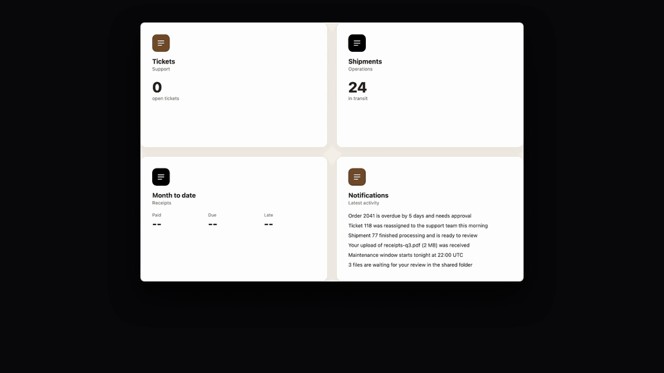

# dashboardlify

[](https://skills.sh/ednaaaj/dashboardlify)

**`dashboardlify`** is an AI skill for Claude Code that builds, tightens and reworks admin dashboards so they look designed instead of generated. Every size, color, radius, shadow and duration comes from a fixed token set, so output is consistent and checkable.

The skill is text files only: no build step, no dependencies. The optional scan needs Node 22 and Chrome, nothing to install. The only binaries in the repo are the demo video and its looping preview in `docs/`.



[Watch the 20 second demo with sound](docs/promo.mp4). `/dashboardlify:improve` flags the wrong components, finds roles and guarded routes, fills a pages x roles x states grid, and ends on a measured before/after.

## Quick start

```
/plugin marketplace add ednaaaj/dashboardlify
/plugin install dashboardlify@dashboardlify
```

Restart Claude Code, open your project, then:

```
/dashboardlify:improve http://localhost:3000
```

One command. It measures the page, decides what it needs (colors, layout, components), applies it, and reports how much of the first screen visibly changed. A rework step always waits for your approval before editing code.

## What it fixes

Typical "AI dashboard" problems it targets:

- Random spacing (5px, 10px, 18px) and 10+ font sizes
- Five different border radii, heavy shadows on every card, nested cards
- Gradients, glow, glass and emoji icons used as decoration
- Several accent colors, low-contrast grey text, mixed icon sets
- Bouncy, looping or slow animations

## Modes

| Mode | Use it when | What it changes |
|---|---|---|
| **A. Build** | Starting a new dashboard | Whole screen, from tokens |
| **B. Tighten** | You have a dashboard and want it cleaned up | CSS values only. Behavior and structure stay the same |
| **D. Arrange** | The dashboard looks messy or "nothing changed" after a tighten | Layout through CSS only: top bar and hero height, card grid, padding, icon tiles. No JSX |
| **C. Rework** | You want layout, hierarchy, charts and density reworked | Structure too. It writes a brief first and waits for your approval before touching code |

Two style presets, pick one per product:

- `crisp` (default): radius up to 8, hairline borders, no shadows
- `soft`: cards 12-16, pill controls, tinted page behind cards

Three densities: compact (tables, ops), default (mixed), comfortable (settings).

## Install

### As a Claude Code plugin (recommended)

```
/plugin marketplace add ednaaaj/dashboardlify
/plugin install dashboardlify@dashboardlify
```

Slash commands need the plugin.

**Update**

```
/plugin marketplace update dashboardlify
/plugin update dashboardlify@dashboardlify
```

Then restart Claude Code. If the version does not change, reinstall: `/plugin uninstall dashboardlify@dashboardlify`, `/plugin marketplace remove dashboardlify`, then add and install again as above. `/plugin` shows the installed version.

**Old copy showing instead?** If `/dashboardlify` still shows an old description and `/dashboardlify:improve` is missing, a hand-copied folder is shadowing the plugin. Remove it: `rm -rf ~/.claude/skills/dashboardlify` (and `<project>/.claude/skills/dashboardlify` if you copied it per project), then install the plugin.

### Any agent (skills CLI)

Skill only: `npx skills add` installs the skill and no slash commands. Works with Claude Code, Cursor, Codex, Windsurf and others:

```
npx skills add ednaaaj/dashboardlify
```

### Manually

```
git clone https://github.com/ednaaaj/dashboardlify
cp -R dashboardlify/plugins/dashboardlify/skills/dashboardlify ~/.claude/skills/
```

For one project only, copy it into `<project>/.claude/skills/` instead.

## Commands

| Command | What it does |
|---|---|
| `/dashboardlify:improve <url\|file\|--src dir>` | **Start here.** Measures, then decides itself: colors, layout, components. Proves the change is visible |
| `/dashboardlify:build` | New dashboard from tokens |

One step only, if you want it:

| Command | What it does |
|---|---|
| `/dashboardlify:scan <url\|file\|--src dir>` | Measure and print a verdict, no edits |
| `/dashboardlify:tighten <path> [--copy]` | B: whole-app token pass, CSS only |
| `/dashboardlify:arrange [path]` | D: CSS-only layout pass, ends with a visible-change check |
| `/dashboardlify:rework <path>` | C: measure, audit, brief, approve, rebuild |

## Measure first

Every existing-dashboard run starts with a scan, so the work follows evidence instead of taste.

```
node plugins/dashboardlify/skills/dashboardlify/scripts/scan.mjs <url|file.html>... [--json f] [--compare before.json] [--dark] [--width n] [--no-palette] [--combo calm|paper|brand] [--shot f.png] [--visible-change before.png] [--height px] [--no-layout] [--status]
node plugins/dashboardlify/skills/dashboardlify/scripts/scan.mjs --src <dir>   # source-only estimate
```

Add `--status` to also check repeated labels and badges (implies `--inventory`; prints `STATUS OK|FIX|NONE`). Add `--inventory` to also list what each page shows and whether each component suits its data (`INVENTORY FIT|SWAP`), `--storage-state <file>` to scan a logged-in role with a saved state file (values are never printed), and `--block <pattern>` to force an error or empty state. `--src` also prints a ROLES block with the roles, guards and routes it finds.

Needs Node 22 and Chrome. No installs. `--combo calm|paper|brand` picks the colour combo the PALETTE block reports (calm for dense data, paper for warm or consumer products, brand for brand-heavy ones). It counts the things that make a screen look generated: distinct font sizes, radii and colours, off-scale spacing, shadows, gradients, uppercase text, mixed icon sizes, low-contrast text, and long or looping motion.

| Score | Verdict | Meaning |
|---|---|---|
| < 8 | LEAVE | Already tight. At most 3 refinements, no rewrite |
| 8-35 | TIGHTEN | Token pass, CSS only |
| > 35 | REWORK | Structure needs a brief and approval |

Example delta after a tighten run (illustrative numbers):

| Metric | Before | After |
|---|---|---|
| Font sizes | 11 | 5 |
| Radii | 6 | 3 |
| Colours | 24 | 9 |
| Off-scale spacing | 38 | 0 |
| Shadows | 9 | 1 |
| Score | 52 | 6 |

## Components, roles and scenarios

`/dashboardlify:improve` does not stop at the page you point at. Step 0 surveys the app:

- **Components.** The scan lists tables, charts, KPI cards, lists, forms, empty states and placeholder widgets, and checks each against its data: a 12-row monthly table becomes a trend chart, a one-row table of three numbers becomes KPI cards, seven status counts become a sorted bar list, a "Coming soon" card is filled or cut. Rules: `references/metric-to-visual.md`, "Component fit".
- **Roles.** `--src` finds roles (admin, manager, viewer...), guards and routes in the source and marks which routes are guarded.
- **Scenarios.** It builds a pages x roles x states grid (default, empty, loading, error, long data), measures every cell it can reach, and reports each cell as covered or not covered, with the reason. Logged-in roles need a test account or a state file you keep outside the repo; credentials are never stored or printed. Procedure: `references/survey.md`.

The detection is heuristic. Scan output is evidence, not a verdict: the run labels false positives.

## Design checks beyond spacing (v0.5.0)

A page can have perfect spacing and still look generic. Spacing, type scale and radii are the part a token pass can fix. These checks cover the rest, and they work on any app, any words, any language:

- **Identity presets** (`references/identity.md`): editorial (serif headings and KPI numerals, dark warm sidebar, amber accent), product (plain sans, light sidebar, blue accent), ink (slate sidebar, teal accent). `improve` and `rework` show 2 or 3 of them and wait for your choice; none is applied silently. Mode B (`tighten`) never changes the font family, sidebar colour or accent hue.
- **Hierarchy.** One thing leads each card and each page: a KPI card with a label and a number but no context line, or a page with no summary sentence under the title, has no second level to read.
- **Consistency of repeated labels and badges.** `--status` finds any repeated short label or badge, any words: short text where a few values repeat in a table column or list slot, and anything styled as a pill, badge, chip or tag. It then checks them as one system: one style, one colour per value, few colours overall, contrast of at least 4.5:1, and no coloured dot standing alone. Rules: `references/status.md`.
- **Grouping and density.** A long table gets filter tabs with counts; a flat list of dated items gets groups (Overdue, Today, This week); a table with a state column and a percent column becomes project rows with a progress bar and a pill; a people list with a number each becomes capacity bars.
- **Content around the numbers.** A context line under each KPI (change or next step), one summary sentence under the page title that carries the numbers, relative dates ("2 days overdue") next to the absolute one. The last two are advisory: a search input without a shortcut hint, and a page without a summary sentence, never change a verdict.

A column of repeated labels is only called a missing status system when it looks like a state: its heading says status, stage, priority, health, result or risk, or most of its values are known state words, or its values carry different semantic colours while the rest of the page uses pills. A plain Category column is left alone.

**What each layer can and cannot do.** Spacing fixes alone cannot add a status system, a summary sentence, progress bars or a look of its own: the plain and designed fixtures in `examples/` both score 0 on the spacing metrics. Identity, labels and content change those. They need Mode C (markup changes) or an approved preset.

Colour hints: a small English word list (on track, late, paid...) only suggests a tone (green, amber, red, blue, neutral) for recommendations; it is not needed for detection.

Limits: detection is heuristic. The fit rules that look for a state column (`table-status-to-rows`, `long-list-no-filter`) and the date and person rules still use English word lists. Scan output is evidence, not a verdict; the run labels false positives. Table and list labels print empty in `--status` output when the heading sits outside the card.

## Design checks, opt-in (v0.6.0)

`scan.mjs <page> --design` adds seven general checks that spacing numbers cannot see (six feed one DESIGN verdict, the phone check has its own line). They work alone or together with `--status`, and without the flag the output is unchanged:

- **Colour roles** (`accent-no-job`, `primary-button-styles`): one accent hue doing more than three jobs (button, link, active nav, chart, badge, border), or several different filled-button colours.
- **Focal point** (`no-focal-point`): nothing clearly larger than body text, or several differently styled elements crowding the top size.
- **Hue count** (`too-many-hues`): more than three hue families once status labels and chart series are set aside.
- **Closeness** (`weak-grouping`): the gap between cards is not clearly bigger than the gap inside them.
- **Phone size** (`phone-size`, its own `PHONE OK|FIX|SKIP` line, not part of the DESIGN verdict): measured at 390px wide only when the page's viewport meta says `width=device-width`; otherwise `PHONE SKIP`. Looks for sideways scroll, text under 12px, tap targets under 40px.
- **Emphasis budget** (`contrast-overspent`): more than three filled buttons, solid badges or large bold coloured texts competing.
- **Squint** (advisory, never changes the verdict): where the heaviest region of the first screen sits and whether it covers the largest text.

Every finding is then decided as CHANGE, KEEP (with a reason) or ASK (a brand or intent decision) instead of being applied blindly. Rules, thresholds, the decision procedure and false-positive risks: `references/design-checks.md`. Real output from `examples/clean-dashboard.html` and `examples/northwind-team-designed.html` (`--design --no-palette --no-layout`):

```
DESIGN OK  (accent azure in 2 roles, 1 button fill, 1 hue, type 1.85x (2 styles near largest), neutral ~100%, grouping 4x, loud 1)
advisory: squint: heaviest region of the first screen at x 70% y 0% (25% x 24%, 14% of the contrast weight) holds div.card; covers a largest-size text "8,742" (likely headline or KPI) (heuristic thumbnail pass, never changes the verdict)

PHONE FIX  (0 texts under 12px, 8 targets under 40px, scrolls sideways)
- phone-size: at 390px wide: page scrolls sideways (802px wide at 390px; widest: main.main to 802px, div.top to 770px, div to 770px; a table overflows); 8 tap targets under 40px (smallest a 36px, a 36px, a 36px) -> CSS fix (Mode B) (design-checks.md)

DESIGN FIX  (accent orange in 1 role, 1 button fill, 4 hues, type 2.29x (1 style near largest), neutral ~99%, grouping 16x, loud 1)
- too-many-hues: 4 hue families (max 3): orange 30-59deg 37%, green 120-149deg 33%, red 0-29deg 22%, azure 210-239deg 8% -> CSS fix (Mode B) (design-checks.md)
advisory: squint: heaviest region of the first screen at x 0% y 32% (25% x 24%, 22% of the contrast weight) holds aside; does not cover any of the 4 largest-size texts on this screen (heuristic thumbnail pass, never changes the verdict)

PHONE SKIP (page declares a desktop viewport or none)
```

`clean-dashboard.html` declares `width=device-width` but has no phone layout, so it is measured and fails honestly; `northwind-team-designed.html` declares no phone viewport, so the phone check is skipped. The second page's four hue families come from its progress bars and dots, which the scan cannot always tell from status colours. The checks are heuristics: the scan is evidence, not a verdict.

## Why did nothing change?

Tighten is a values pass: sizes, colours, radii, spacing. If the real problems are layout (a tall top bar with a big logo, a banner taking a quarter of the first screen, six equal cards with the same icon tile, empty "--" widgets, truncated text, little data above the fold), snapping values to a scale will not move anything you can see.

- Two verdicts. The value verdict is LEAVE / TIGHTEN / REWORK. The LAYOUT verdict is OK (score under 3, or only low-weight JSX notes), ARRANGE (score 3 or more and CSS can fix it, even if some JSX-only notes remain) or REWORK (JSX-only issues dominate: score 14+ with 2 or more JSX issues, or score 5+ with a JSX-only issue of weight 2+). The scan prints both, plus a `NEXT:` line when layout is worse.
- Visible-change gate. Tighten and arrange save a before screenshot and end with `--visible-change`. VISIBLE is 8% or more of the first screen changed, SUBTLE is 3-8%, NOT VISIBLE is under 3%. INCOMPARABLE means the two shots have different widths (exit 1); a different height is cropped to the shorter one. `--shot` and `--visible-change` must be different paths (exit 2 if equal). A NOT VISIBLE result is never reported as success; the run diagnoses why.
- Arrange vs rework. Arrange (`/dashboardlify:arrange`) moves and resizes with CSS and touches no JSX. Rework changes structure, needs an approved brief, and handles what CSS cannot (placeholder widgets, wrapper markup). Arrange marks those issues "needs JSX".

Recipes: `references/layout-recipes.md`.

## Colour matching

The scan also prints a PALETTE block: detected domain (finance, health, logistics, ...) with confidence and signals, the primary colour and where it came from, issues, and a verdict. It is separate from the LEAVE / TIGHTEN / REWORK verdict. Skip it with `--no-palette`.

| Verdict | Meaning | What happens |
|---|---|---|
| KEEP | Colours are cohesive | Never recoloured; only contrast fixes |
| ADJUST | Hue is fine, lightness/chroma/contrast off | Hue kept, contrast fixed, mapped to the curated paired neutral |
| REPLACE | Rainbow or violet-to-pink style gradient | Rebuilt around one curated accent and its paired neutral; asks first if a brand colour is known, otherwise proposes the domain default |

Domain detection (keywords per domain in palettes.json, 28 domains from finance and health to real estate, food, legal, crypto, government, agriculture, gaming and more) only supplies a default accent when no brand colour exists. Each domain has three curated combos with three surface zones in light and dark: a tinted paper page instead of pure white, a brand zone (the accent as a whole surface with light foreground) and an ink zone (dark neutral with light foreground). `calm` suits dense data, `paper` warm or consumer products, `brand` brand-heavy products; every pair is measured at 4.5:1 or better. Output is never greyscale-only. Before recolouring, the agent prints a Color brief. Illustrative example:

```
Color brief
Domain:    finance (confidence high; signals: invoice, payout, ledger)
Verdict:   REPLACE
Primary:   none reliable (violet-to-pink gradient, rainbow charts)
Issues:    hue-to-hue gradient, 5 unrelated chart hues
Proposed:  curated blue + slate; --accent-base light #0d74ce / dark #2870bd (white text), neutrals from slate
Contrast:  white on accent-base 4.7:1 (light) / 5.0:1 (dark) | accent-text on surface 4.5:1 (light)
Combo:     paper (warm editorial feel, white cards on tinted paper)
Zones used: paper page, brand sidebar (#0d74ce, white text), no ink zone
Changes only if verdict is ADJUST or REPLACE
```

Details: `references/color-match.md` (rules), `references/palettes.md` (curated pairs, domain defaults, zones) and `references/palettes/combos.md` (all combos, generated).

## Render only what earns its place

Every region must name the decision it supports. Build picks contents with that test, rework puts the cut list in its brief, and tighten only lists cut candidates without deleting anything. Caps: at most 6 KPIs, one hero chart, loading/empty/error states per region. See `references/render-only.md`.

## Try it

Two sample pages ship in `examples/`:

```
node plugins/dashboardlify/skills/dashboardlify/scripts/scan.mjs examples/slop-dashboard.html
node plugins/dashboardlify/skills/dashboardlify/scripts/scan.mjs examples/clean-dashboard.html
```

The first scores high, the second lands on LEAVE.

For layout, scan the messy home page, then the arranged one. They share identical markup; only the CSS differs:

```
node plugins/dashboardlify/skills/dashboardlify/scripts/scan.mjs examples/messy-home.html --shot /tmp/messy.png
node plugins/dashboardlify/skills/dashboardlify/scripts/scan.mjs examples/arranged-home.html --visible-change /tmp/messy.png
```

The first prints `LAYOUT ARRANGE` (score 15) with its issue list, plus a note `also needs JSX: placeholder-widgets (rework)`. The second prints `LAYOUT OK` with notes and a VISIBLE CHANGE against the first screenshot.

## How to use

Open Claude Code in your project and ask in plain words. The skill triggers on dashboards, admin panels, analytics views, data tables and settings pages. You can also call it directly with `/dashboardlify`.

Not sure which mode? Run `/dashboardlify:improve <url>` and let the scan choose.

| You say | Mode |
|---|---|
| "Build me an orders dashboard, compact, crisp" | A |
| "Tighten this dashboard" / "clean up the spacing and colors" / "swap in tokens" | B |
| "Move things around" / "it looks messy" / "tighten changed nothing" | D |
| "Rework the home page" / "reorganize the layout" / "turn this table into charts" | C |

What happens:

1. **Build:** picks density and preset, imports `tokens.css`, builds shell then page then components, adds empty/loading/error states, runs `checklist.md`.
2. **Tighten:** scans first, then greps your source for off-scale spacing, extra radii, raw hex, shadows and long durations, maps them to tokens, then re-checks.
3. **Rework:** measures the current UI (`measure.md` snippet gives region sizes, color and font histograms, contrast failures, icon sizes), audits it against 18 checks, writes a before/after brief, and only edits code after you approve.

Tip: commit or branch first. Modes B and C edit files in place.

## Using the tokens directly

`references/tokens.css` is plain CSS variables and works without the skill:

```css
@import './tokens.css';

.card {
  padding: var(--card-pad);
  border: 1px solid var(--border);
  border-radius: var(--radius-lg);
  background: var(--surface);
  transition: border-color var(--dur-fast) var(--ease-out);
}
```

- Light and dark via `data-theme`, density via `data-density`, preset via `data-style="soft"`
- Existing app with its own variables? Map them onto the token names in a small bridge file instead of rewriting every rule

## Core rules (short version)

1. One accent color, everything else neutral (tinted toward the accent, never greyscale-only)
2. 4px spacing scale: 0, 2, 4, 8, 12, 16, 20, 24, 32, 40, 48, 64
3. Type sizes 12 / 13 / 14 / 16 / 20 / 24, one font family, weights 400 / 500 / 600
4. Radius by preset, never above 16 except fully round
5. Borders instead of shadows. Shadows only on floating layers (menu, popover, modal)
6. Motion 120-220ms, transform and opacity only, nothing over 300ms, no bounce
7. Text contrast at least 4.5:1, no decoration without information

## What is inside

```
plugins/dashboardlify/skills/dashboardlify/
├─ SKILL.md            entry point: modes A-D, hard rules, procedures
├─ checklist.md        verify before you call it done
├─ scripts/scan.mjs    measure a page or source dir, print verdicts, screenshots
└─ references/
   ├─ tokens.css       the variables (copy, do not retype)
   ├─ tokens.md        scales and when to use each
   ├─ color.md         neutral ramp, accent, status, charts
   ├─ color-match.md   KEEP / ADJUST / REPLACE rules, legibility, Color brief
   ├─ palettes.md      curated pairs, 28 domains, zones and combos, dark mode, charts
   ├─ palettes/        palettes.json (scales, domains, combos, contrast), combos.md (generated), NOTICE.md
   ├─ render-only.md   which regions earn a place, caps, cut list
   ├─ layout.md        shell, grid, page widths, numeric targets
   ├─ layout-recipes.md  CSS fixes per LAYOUT issue (Mode D), hierarchy checklist
   ├─ density.md       compact / default / comfortable
   ├─ components.md    cards, tables, forms, charts, nav, states
   ├─ motion.md        allowed transitions and reduced motion
   ├─ copy.md          opt-in copy pass (--copy)
   ├─ anti-slop.md     62 patterns to avoid, each with a fix
   ├─ redesign.md      Mode C (rework) procedure, audit, brief template
   ├─ measure.md       browser snippet to measure an existing UI
   ├─ metric-to-visual.md  which chart or display fits which metric
   ├─ patterns.md      common dashboard layouts
   ├─ stack.md         free libraries worth adding, and which to skip
   └─ examples/        notes on linear, vercel, stripe, supabase, posthog, mercury, attio, shadcn
```

## Limits

- Works best on web dashboards (React, Vue, plain HTML/CSS, Tailwind)
- Does not generate images, logos or illustrations
- Mode C needs a screenshot or running app to measure well. Without one, numbers are estimates and it says so
- Does not replace a designer for brand work

## License

Licensed under the terms in [LICENSE](LICENSE).
